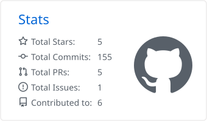
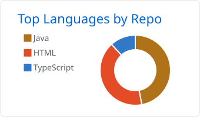

## Hi, I'm Naveen Kumar Vunnam

I'm a Senior Software Engineer in Hyderabad, India. For the last 4+ years I've built software for capital markets trading: low-latency trading systems, event-driven microservices, and more recently agentic AI workflows.

More about my work is on my [portfolio](https://naveen219.github.io/naveen-kumar-vunnam/).

### Tools I use most

  

### Certifications and writing

- Oracle Certified Professional, Java SE 11 (2025)
- Microsoft Azure Fundamentals, AZ-900 (2022)
- [Securing Data Communication Using Blockchain](https://www.researchgate.net/publication/372529973_SECURING_DATA_COMMUNICATION_USING_BLOCKCHAIN) (2023), a paper built on Python, Django and IPFS

### GitHub stats

<picture>
  <source media="(prefers-color-scheme: dark)" srcset="https://raw.githubusercontent.com/Naveen219/Naveen219/master/profile-summary-card-output/github_dark/3-stats.svg" />
  
</picture>
<picture>
  <source media="(prefers-color-scheme: dark)" srcset="https://raw.githubusercontent.com/Naveen219/Naveen219/master/profile-summary-card-output/github_dark/1-repos-per-language.svg" />
  
</picture>

<picture>
  <source media="(prefers-color-scheme: dark)" srcset="https://streak-stats.demolab.com/?user=Naveen219&theme=dark&hide_border=true" />
  
</picture>

### Get in touch

[Portfolio](https://naveen219.github.io/naveen-kumar-vunnam/) · [LinkedIn](https://www.linkedin.com/in/naveen-kumar-vunnam/) · [Email](mailto:naveennavy219@gmail.com)
